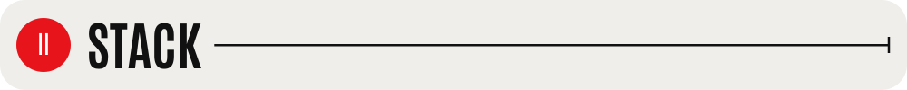
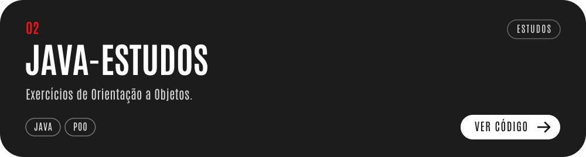
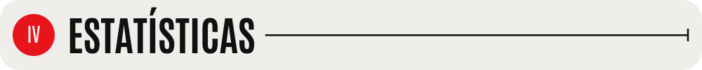
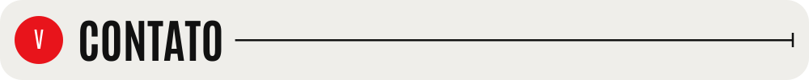
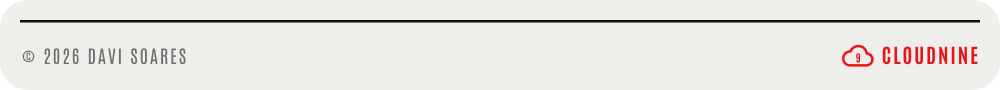

<table>
<tr>
<td width="55%" valign="middle">
```java
public class Davi {
    String usuario = "CloudNine-dav";
}
```
</td>
<td width="45%" align="center">

</td>
</tr>
</table>



<a href="https://github.com/CloudNine-dav/pdfoffice"></a>
<a href="https://github.com/CloudNine-dav/java-estudos"></a>

<p align="center">
  
  
</p>




<p>
  <a href="https://github.com/CloudNine-dav"></a>
  <a href="https://instagram.com"></a>
</p>

